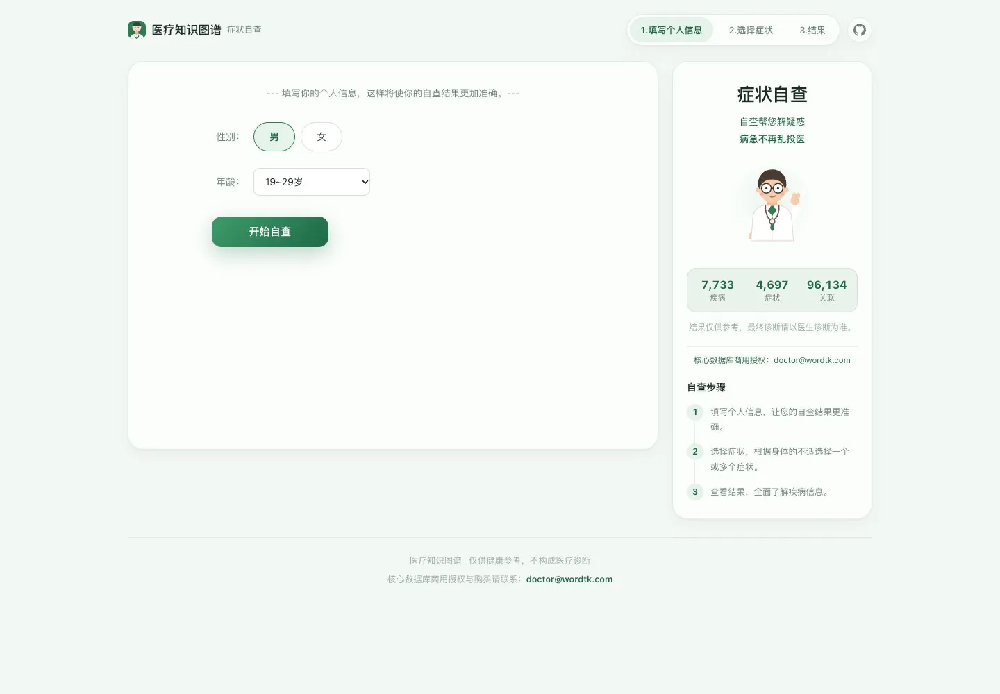
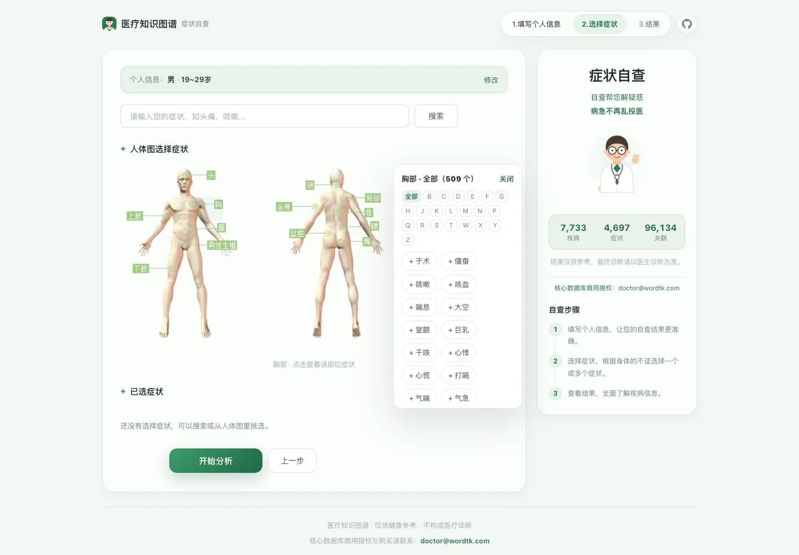
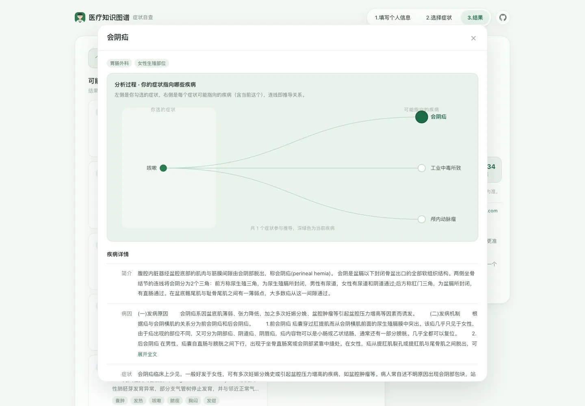
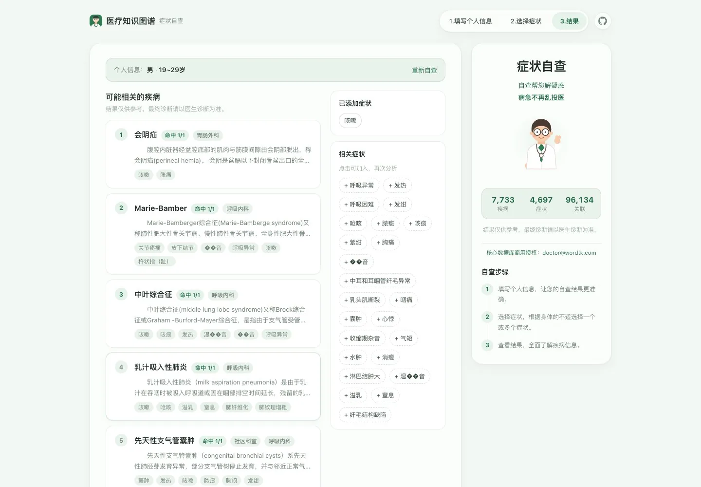

<div align="center">


# Doctor

**医疗知识图谱 — symptom self-check on a medical knowledge graph, one page, three steps, one Worker.**

<a href="https://doctor.wordtk.com"></a>

<br/>


<br/><br/>

🇺🇸 **English** &nbsp;·&nbsp; [🇨🇳 简体中文](README.zh-CN.md)

<br/>



</div>

> Fill in sex and age, tap a body part, pick symptoms. Doctor walks a disease ↔ symptom graph,
> screens out departments that cannot apply, and ranks candidate diseases by how much of your input
> they explain. Educational self-check only — **not** a diagnostic device.

---

## Table of contents

| | |
| --- | --- |
| [What it does](#what-it-does) | [How it decides](#how-it-decides) |
| [Screens](#screens) | [Quick start](#quick-start) |
| [API](#api) | [Using the full dataset](#using-the-full-dataset) |
| [Deploy](#deploy) | [Project layout](#project-layout) |
| [Cost and limits](#cost-and-limits) | [License](#license) |

---

## What it does

- **One page, three steps** — profile → symptoms → result. No route changes, no full reloads.
- **Body map as the primary picker** — front and back figures, with hotspots for
  head, chest, abdomen, waist, pelvis, limbs. Hovering the head expands 眼/鼻/口/牙/耳/眉 in place.
- **Symptom panel floats beside the figure** — hundreds of symptoms per region, with an A–Z pinyin
  filter, so the page never jumps around.
- **Reasoning graph in a modal** — open any result and see your symptoms on the left, the diseases
  they point to on the right (the current one highlighted), and the edges that connect them.

## How it decides

1. Map each picked symptom onto the disease ↔ symptom graph.
2. Reverse-walk the edges: which diseases point at these symptoms.
3. Screen out departments by sex and age (妇科 / 男科 / 小儿科 / 老年科).
4. Rank by matched count, then by `matched / disease.symptomCount + matched × 0.1`.

The list is ordered by **how many of your symptoms each disease explains**; the ring in the UI shows
relative strength within the result set, not a probability.

## Screens

<div align="center">

| Body map with the symptom panel | Reasoning graph in the result modal |
| --- | --- |
|  |  |



</div>

## Quick start

```bash
npm install

# 1. local schema
npx wrangler d1 execute doctor --local --file=./migrations/0001_init.sql

# 2. build the demo dataset from the sample dump
node scripts/convert-mysql-dump.mjs db/sample-dump.sql

# 3. load it
node scripts/load-d1.mjs --local

# 4. run
npm run dev          # http://127.0.0.1:8788
```

`npm test` runs the algorithm unit tests, `npm run check` runs typecheck plus tests.

## API

All endpoints are JSON under `/api/`. Errors share one shape: `{ "error": "…", "code": "…" }`.

| Method | Path | Purpose |
| --- | --- | --- |
| `GET` | `/api/health` | smoke test + dataset size |
| `GET` | `/api/symptoms/search?q=&limit=` | autocomplete, Chinese or pinyin |
| `GET` | `/api/symptoms?part=&letter=&limit=` | symptoms of a body part, optional A–Z filter |
| `GET` | `/api/parts` | body part tags with counts |
| `POST` | `/api/analyze` | the self-assessment call |
| `GET` | `/api/diseases?q=` | disease search |
| `GET` | `/api/diseases/:id` | full disease record |
| `GET` | `/api/graph/explain?id=&symptoms=&per=` | reasoning graph: symptoms → diseases |
| `GET` | `/api/graph?id=` | attribute graph for one disease |

```bash
curl -X POST https://doctor.wordtk.com/api/analyze \
  -H 'content-type: application/json' \
  -d '{"sex":"female","age":28,"symptoms":["头痛","恶心"]}'
```

Chinese sex values and age ranges are accepted too, e.g.
`{"sex":"女","age":[28,35],"symptom":["头痛"]}`. Full field reference:
[docs/en/api.md](docs/en/api.md).

## Using the full dataset

The repository ships a hand-written demo subset only. The complete knowledge base is distributed
separately under a commercial license.

```bash
mkdir -p _data && cp /path/to/robot.sql _data/     # 120+ MB mysqldump
node scripts/convert-mysql-dump.mjs               # -> build/seed-*.sql
node scripts/load-d1.mjs --local                  # or --remote
```

The converter reads the mysqldump directly: it parses `CREATE TABLE` for column order, folds the
side tables that store list columns back into JSON arrays, derives sex/age department scopes,
computes pinyin keys, and emits chunked SQL small enough for `wrangler d1 execute`.

### Split the import across days

One full import is about **173,000 row writes**; the free tier allows **100,000 per day**. Split it
first, then load one batch per day:

```bash
npm run data:days                        # build/day-1 + build/day-2 + days.json
npm run data:load -- --remote --day 1    # ~86.7k writes
npm run data:load -- --remote --day 2    # the rest, next day
```

`days.json` records the row count and the table mix of each batch, so you can see the cost before
running it.

## Deploy

```bash
npx wrangler login
npx wrangler d1 create doctor          # copy the returned database_id
# paste it into wrangler.jsonc, then:
npm run data:load -- --remote
npm run deploy
```

The Worker is bound to `doctor.wordtk.com` through a `routes` entry with `custom_domain: true`, and
the `workers.dev` subdomain is disabled so there is only one public entry point.

## Project layout

```
src/
  index.ts            Worker entry, /api/ dispatch, error envelope
  http.ts             JSON helpers, edge cache wrapper
  db.ts               D1 helpers, row -> DTO mapping
  lib/diagnose.ts     scoring + ranking, pure and unit tested
  routes/             health, symptoms, parts, analyze, diseases, graph
public/
  index.html          single page shell (three steps)
  assets/app.css      layout and theme
  assets/app.js       step flow, body map, search, d3 reasoning graph
  assets/body/        front/back body figures
  assets/vendor/      d3 v3 (loaded only when a result is opened)
migrations/           D1 schema
db/sample-dump.sql    hand-written demo subset in mysqldump format
scripts/              dump converter, day splitter, D1 loader
tests/                algorithm tests
```

## Cost and limits

Static asset requests do not count as Worker invocations, and the API surface is small. As of
October 2026 the free plan allows 100,000 Worker requests/day with 10 ms CPU each, and D1 allows
5 million rows read/day and 100,000 rows written/day. Verify against the
[official limits](https://developers.cloudflare.com/workers/platform/limits/) before relying on them.

The hot path is one indexed join plus in-memory scoring, so CPU is not the constraint — row reads
are. That is why lookups are index seeks instead of `LIKE '%…%'` scans.

## License

Copyright (C) 2026 onblog.

The code is licensed under **AGPL-3.0-only** — see [LICENSE](LICENSE). You may use, modify,
self-host and even sell it, provided that any derivative work, and any network service built on
top of it, is released under the same license.

If that does not fit your case (closed-source distribution, or a closed-source hosted service), a
**commercial license** is available: <hello@wordtk.com>.

The **dataset** is not covered by AGPL-3.0. It is licensed separately under a commercial
agreement, so this repository ships only a small hand-written sample.

---

<div align="center">

**Doctor** · built with Cloudflare Workers, D1 and d3

<a href="https://doctor.wordtk.com">Live demo</a> ·
<a href="docs/en/api.md">API</a> ·
<a href="README.zh-CN.md">简体中文</a>

<sub>Output is for education and self-awareness only. It is not a diagnosis, treatment plan or
prescription advice, and it does not replace a doctor.</sub>

</div>
